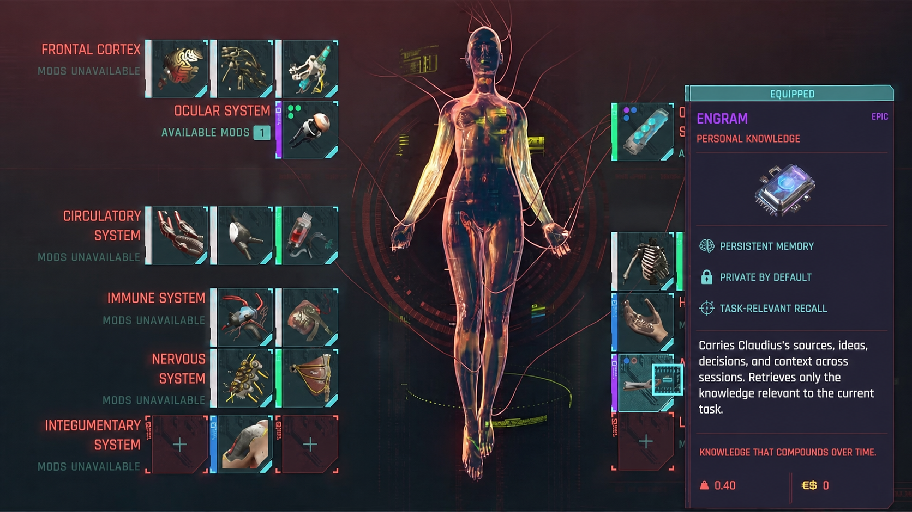
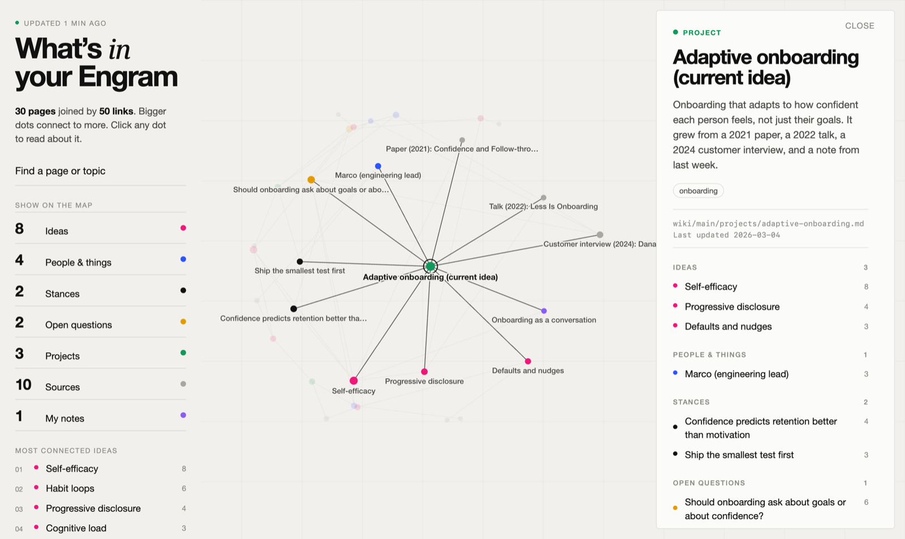

# Engram

**Your mind, 10x. An AI memory that connects everything you have ever learned to what you are thinking about now.**

If your job runs on knowledge, you read, meet, and think far more than one head can hold. The paper you read three years ago may be exactly what today's idea needs, but you will not remember it. Engram remembers it for you and makes the connection.



## Old knowledge, new ideas



*A sample Engram. Priya, a product lead, is shaping a new idea: onboarding that adapts to how confident people feel. Engram connected it to a paper she saved in 2021, a conference talk from 2022, a customer interview from 2024, and a note she wrote last week. She had long forgotten most of them.*

Every dot is a page your AI wrote and keeps up to date. Every line is a connection it found. Click any dot to see everything that feeds into it.

## How it works

1. **Capture as you go.** Papers, articles, talks, meetings, customer interviews, your own notes. One sentence is enough: *"Digest this."* Your AI keeps the original and writes a short page about it.
2. **Engram connects it to everything you already have.** Each new thing is linked to the ideas, people, open questions, and projects already in your Engram, no matter how long ago you saved them.
3. **Your past shows up when you need it.** Working on something new? Ask *"What do I already know that relates to this?"* Your AI answers from your own Engram and shows where each piece came from: the 2021 paper, the customer quote, last week's note.
4. **See your thinking.** Open **Engram Graph** to see how it all connects, and which ideas keep coming back.

The more you add, the more it can connect. Every new source makes your old ones more useful.

## What Engram keeps

| | Kind | What it holds | In Priya's Engram |
| --- | --- | --- | --- |
| 🔴 | **Ideas** | Concepts you keep running into | *Self-efficacy*, *Progressive disclosure*, *Habit loops* |
| 🔵 | **People & things** | Colleagues, customers, companies, tools | *Dana (customer)*, *Marco (engineering lead)* |
| ⚫ | **Stances** | What you believe, in your words | *Confidence predicts retention better than motivation* |
| 🟠 | **Open questions** | Things you are still figuring out | *Why do new users drop off on day 3?* |
| 🟢 | **Projects** | What you are working toward | *Adaptive onboarding*, *Q1 retention push* |
| ⚪ | **Sources** | Papers, talks, interviews, meeting notes, articles | *Paper (2021): Confidence and Follow-through* |
| 🟣 | **My notes** | Your own writing, kept exactly as you wrote it | *Onboarding as a conversation* |

## Things you can say

| You say | Engram does |
| --- | --- |
| "What do I already know that relates to this idea?" | Pulls together your past sources, ideas, and notes on it, and says where each came from |
| "Digest this paper." | Saves the original, writes a page, links it to what you already have, then asks what stood out to you |
| "File this as a note: …" | Saves your words as a note, untouched |
| "What have I read about onboarding?" | Answers from your own pages, with links |
| "What changed this week?" | Writes a short weekly recap |
| "Check my Engram for loose ends." | Finds stale pages, missing links, and contradictions |

## Get started

You need a computer, about ten minutes, and an AI app that can work with files in a folder (for example Claude, Codex, or Cursor).

1. **Install Node.js** from [nodejs.org](https://nodejs.org/en/download). You only do this once.
2. **Create your Engram.** Open Terminal (on Windows, PowerShell), paste this line, and press Enter:

   ```sh
   npx github:ClaudiusMa/engram init ~/Engram
   ```

   This makes a folder called **Engram** in your home folder.
3. **Open that folder in your AI app** and say: *"Read AGENTS.md and help me get started."*
4. **Save your first thing:** *"Digest this article: (paste a link)"*.
5. **See your map:** on a Mac, double-click **Engram Graph** inside your Engram folder. (Elsewhere, ask your AI to run `npm run graph`.)

## Your knowledge stays yours

- Everything lives in plain files in your own folder. No account and no Engram server.
- What you save is never uploaded by Engram. If you use Git, your knowledge folder is excluded from the shareable part by default.
- Your originals are never changed or deleted. Your own notes and takes are never rewritten with ideas you did not have.
- The files are ordinary Markdown, so you can read them in any notes app, and they outlive any one tool.

## Staying up to date

Engram checks for improvements on its own: when you open **Engram Graph**, and when your AI starts a session. If an update is ready, it tells you and waits. **Nothing is installed until you say OK.**

An update only changes how Engram works. Your notes, sources, and pages are never touched. If you changed one of Engram's own instruction files, your version is kept, and the new one is saved beside it for your AI to merge with you.

Set up Engram before updates existed? Run the step 2 command once more in your Engram folder (`npx github:ClaudiusMa/engram init .`). It adds anything new and leaves your files alone.

<details>
<summary><strong>For builders: how Engram is put together</strong></summary>

### The idea

An LLM should not rediscover your knowledge from raw files every time. Instead it maintains a persistent wiki of plain Markdown: source pages, concept, entity, position, question, and project pages, an index, and a log. `AGENTS.md` routes each request to one workflow in `schema/workflows/`. No database, plugins, or vector search are required.

### Folder layout

```text
Engram/
├── AGENTS.md            # entry point every agent reads
├── Engram Graph.app     # double-click map (macOS)
├── bin/                 # setup, graph, and update tools
├── schema/              # workflows, templates, skills
├── artifact/            # temporary AI-made outputs (private)
└── wiki/main/           # your knowledge (private)
    ├── raw/             # originals, the source of truth
    ├── sources/  notes/  concepts/  entities/
    ├── positions/  questions/  projects/  human-skills/
    ├── index.md
    └── log.md
```

### Page types

- `source`: an annotation of one original in `raw/` (`file:` frontmatter plus a `## Source` embed), with a factual `## What's in this source` and the user's confirmed `## My take`. It never copies the original.
- `note`: user-authored text; the body is the user's voice. Digest requests always become sources, never notes.
- `concept` (idea), `entity` (person or thing), `position` (stance), `question`, `project` (a pointer to an external project, never its content).
- `human-skill`: a private playbook for something the human practices, loaded only through its own intent gate.

### Workflows

Ingest, note, clean transcript, query, lint, recap, artifact, artifact sync, connect project, human skill, and optional ProductLab integration. Each lives in `schema/workflows/`. System edits require showing the change and getting the user's consent first.

### Privacy model

In a default install the `.gitignore` ignores everything, then allows only public structure (`AGENTS.md`, `README.md`, `LICENSE`, `package.json`, `bin/`, `schema/`). `wiki/` and `artifact/` stay local.

### Graph and updates

- `npm run graph` (or the app) scans `wiki/main/` and writes a self-contained page to the system temp folder. `raw/`, `human-skills/`, `index.md`, and `log.md` are left out.
- `node bin/engram-update.mjs check|apply|later` checks GitHub at most about once a day, installs only on request, and records installed file fingerprints in `.engram/installed.json` to tell user edits from untouched files.

### Frontend notes

Markdown stays plain: `[[wikilinks]]` and `![[embeds]]`, no plugin syntax. The initializer ships conservative Obsidian defaults. Hide `raw/`, `index.md`, `log.md`, `artifact/`, and structure files from any graph view.

### Verify

```sh
npm test
```

</details>

## License

MIT
